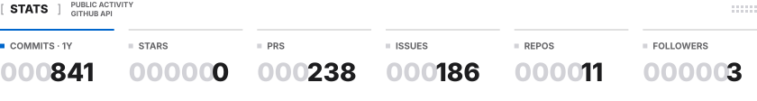
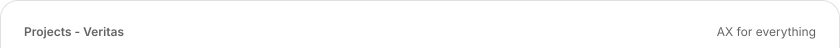
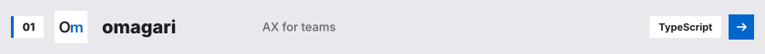
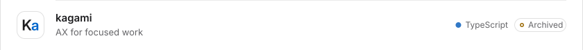
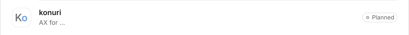
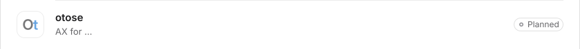
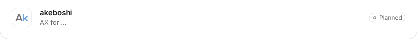
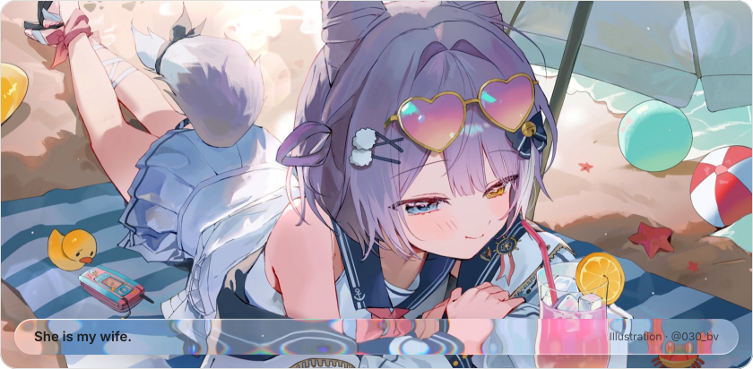

<picture>
  <source media="(prefers-color-scheme: dark)" srcset="assets/header-dark.svg">
  
</picture>

<picture>
  <source media="(prefers-color-scheme: dark)" srcset="assets/stats-dark.svg">
  
</picture>

<picture>
  <source media="(prefers-color-scheme: dark)" srcset="assets/hours-dark.svg">
  
</picture>

<!-- projects -->

<picture><source media="(prefers-color-scheme: dark)" srcset="assets/projects-0-dark.svg"></picture><a href="https://github.com/Pancheble/omagari"><picture><source media="(prefers-color-scheme: dark)" srcset="assets/projects-1-dark.svg"></picture></a><a href="https://github.com/Pancheble/kagami"><picture><source media="(prefers-color-scheme: dark)" srcset="assets/projects-2-dark.svg"></picture></a><picture><source media="(prefers-color-scheme: dark)" srcset="assets/projects-3-dark.svg"></picture><picture><source media="(prefers-color-scheme: dark)" srcset="assets/projects-4-dark.svg"></picture><picture><source media="(prefers-color-scheme: dark)" srcset="assets/projects-5-dark.svg"></picture>

<!-- /projects -->

<!-- banner -->

<a href="https://x.com/030_bv/status/2095118743928291753">
<picture>
  <source media="(prefers-color-scheme: dark)" srcset="assets/banner-dark.svg">
  
</picture>
</a>

<!-- /banner -->
